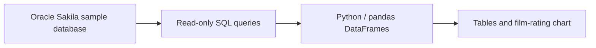
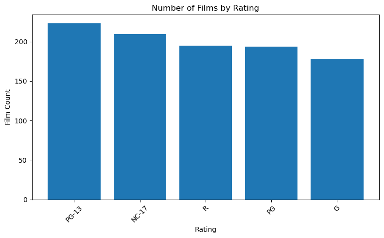

# Sakila Video Rental Database Analysis

**Aaron Gabriel · SQL, Python, and relational data analysis**

An exploration of a sample video rental business: understand the relationships
behind rentals, inspect film inventory, and turn SQL results into a clear chart.
Developed for **ADS 507 Practical Data Engineering, Modules 3 and 4**, at the
University of San Diego.

## What this project demonstrates

- Mapping a rental workflow across related tables and foreign keys.
- Querying MySQL with joins, aggregation, subqueries, and an anti-join.
- Bringing SQL results into pandas and visualizing them with Matplotlib.
- Explaining what a query measures and the limits of the result.



## Findings from the original coursework run

| Question | Saved result |
| --- | --- |
| How many films are in the catalog? | 1,000 across five ratings |
| Which rating has the most titles? | PG-13: 223 |
| How many distinct titles have inventory records? | 958 |
| How many films have no inventory records? | 42 |
| Where are stores located? | Lethbridge and Woodridge |
| Which actor appears in every category and has the most distinct films? | Gina Degeneres: 42 films |



**Provenance:** tables and the chart come from Aaron's saved February 2, 2026
notebook outputs. They have not been recomputed for this portfolio copy. The SQL
is unchanged; the connection code was rewritten to use secure runtime settings
and SQLAlchemy with PyMySQL. That revised code has received static checks only.

Inventory presence is different from current rental availability. The 42-film
query finds titles without inventory rows; it does not find films whose copies
are all on loan. Revenue and retention are business motivations from Module 3,
not measured outcomes of this analysis.

## Explore the project

| File | Purpose |
| --- | --- |
| [Notebook](sakila_analysis.ipynb) | Walkthrough, SQL, saved result tables, and chart |
| [SQL queries](sql/analysis.sql) | Five standalone, read-only MySQL queries |
| [Schema notes](docs/schema.md) | Rental workflow and key relationships |
| [Validation notes](docs/validation.md) | What was checked and what remains untested |
| [Offline validator](scripts/validate_package.py) | JSON, Python syntax, output, and SQL consistency checks |

## Run locally

1. Install MySQL and the sample database following [Oracle's Sakila installation
   instructions](https://dev.mysql.com/doc/sakila/en/sakila-installation.html).
   Use a disposable local sample database: the upstream installation scripts
   recreate the `sakila` schema. This repository does not redistribute database dumps.
2. Use **Python 3.10 or later** and create a local environment:

   ```sh
   python3 -m venv .venv
   source .venv/bin/activate
   python -m pip install -r requirements.txt
   ```

3. Supply an existing MySQL account with read access to Sakila. The example name
   below is a placeholder; this project does not create accounts or grant access.

   ```sh
   export SAKILA_DB_USER='your_existing_read_user'
   export SAKILA_DB_HOST='127.0.0.1'
   export SAKILA_DB_PORT='3306'
   export SAKILA_DB_NAME='sakila'
   ```

   The notebook asks for the password privately through `getpass`. It also accepts
   `SAKILA_DB_PASSWORD` when already supplied by your local environment; do not
   place a password in notebook code, shell history, or tracked configuration.
   `config.example.env` is a non-secret reference. If using a local copy, load it
   before launching Jupyter with `set -a; source config.local.env; set +a`.

4. From the repository root, start Jupyter:

   ```sh
   jupyter lab sakila_analysis.ipynb
   ```

   Read the saved results first, or restart the kernel and run all cells to query
   your installed sample database. A new run replaces the saved output snapshot.
   Review outputs for credentials or personal information before committing.

The five queries can also run directly in a MySQL client after selecting `sakila`.
The notebook uses a [SQLAlchemy connection](https://docs.sqlalchemy.org/en/20/core/engines.html)
with [pandas `read_sql_query`](https://pandas.pydata.org/docs/reference/api/pandas.read_sql_query.html).
Dependency ranges are supplied for setup; a fresh environment and live MySQL run
have not been validated during this preparation.

## Scope and attribution

Module 3 documented the rental business scenario and schema relationships.
Module 4 implemented SQL queries, DataFrame inspection, and a bar chart using
MySQL, PyMySQL, pandas, and Matplotlib. This is a database analysis project;
cloud ingestion, ETL orchestration, deployment, and production monitoring are
outside its implemented scope.

**Oracle's Sakila sample database supplies the schema and sample data.** Aaron's
work is the business framing, relationship discussion, SQL analysis, and
visualization, rather than authorship of the underlying database. See the
[official Sakila documentation](https://dev.mysql.com/doc/sakila/en/) for source
and licensing. Original course PDFs and worksheets are excluded from this package.

OpenAI Codex assisted with portfolio packaging, credential removal, connection
refactoring, documentation, and static validation. No open-source license for
Aaron's work has been selected as part of this review package.
